  
  
  

<!-- loc-start -->

  

<!-- loc-end -->

<!-- hours-start -->

  

<!-- hours-end -->

I build local-first apps and small AI models that run on your machine, not someone else's. I'm a solutions engineer in Canada.

## Now

**[Sirius](https://huggingface.co/ansarbuilds/Sirius-Core)** is a focus aid for ADHD that runs entirely on your Mac. It reads only the title of the window in front of you and asks two small models of my own (32.5 MB each, about 7 ms on the CPU) whether it fits your work. Drift for two minutes and it checks in once, gently. Mac beta in progress. [Try the models in your browser](https://huggingface.co/spaces/ansarbuilds/sirius-demo).

## Shipped

**[Hermione](https://huggingface.co/ansarbuilds/hermione-models)**
Jira and Confluence as one file on your Mac, with a small AI model that runs offline. Custom 2B models, fine-tuned and gated on unseen requests before they ship.

**[saywhen](https://ansarbuilds.dev/work/saywhen/)**
Look at the screen and talk. It types, then waits before it sends. My first open-source app, a Mac and Windows beta. [On GitHub](https://github.com/ansarbuilds/saywhen).

**[Haloscript](https://ansarbuilds.dev/work/haloscript/)**
A writing studio for novelists on Mac, iPad and iPhone, syncing through your own iCloud. My second App Store app. [On the App Store](https://apps.apple.com/ca/app/haloscript/id6820670080).

**[Agent Flight Recorder](https://ansarbuilds.dev/work/agent-flight-recorder/)**
When a coding agent breaks a test, it shows which edit did it. [On GitHub](https://github.com/ansarbuilds/agent-flight-recorder) and [PyPI](https://pypi.org/project/flightrecorder-ai/).

Also: [RepTrack](https://apps.apple.com/us/app/reptrack-workout-log/id6761032027) on the App Store, [StoryEra](https://github.com/ansarbuilds/storyera), and studies re-running published AI claims ([PRH-JEPA](https://github.com/ansarbuilds/prh-jepa), [REA](https://github.com/ansarbuilds/rea-study)). The full story of each is on the [portfolio](https://ansarbuilds.dev).

## Tools

| Area | What I reach for |
|---|---|
| Data | SQL, Snowflake, Python, DuckDB, dbt |
| Apps | Swift, SwiftUI, Tauri, Rust, TypeScript, React |
| On-device AI | PyTorch, Unsloth, llama.cpp, ONNX, Whisper |
| Working with agents | Claude Code, Codex, MCP |

AI coding tools speed up the build. I still own the problem, the tests and the final call, and I publish what failed next to what worked.

  If a project is useful, <a href="mailto:mohamedansarkms@gmail.com"><b>say hi</b></a>.

<!-- The banner is generated by assets/generate_banner.py. Leave assets/hero.svg alone. -->
