  
  
  

**Solutions Engineer at [Datasembly](https://www.datasembly.com/)**, in Canada. Previously at Amazon Prime Video.

I build agents, test AI claims in public, and take small products from idea to release.

## Now

**[saywhen](https://ansarbuilds.dev/#project/saywhen)** is hands-free voice input for terminals and coding assistants. Look at the screen, say the command, and it types it. A preview sits in front of every send, and you can cancel. Open source beta.

## Selected work

**[Agent Flight Recorder](https://github.com/ansarbuilds/agent-flight-recorder)**
A local black box for coding agents. It keeps the run and points at the edit that broke the test. [On PyPI](https://pypi.org/project/flightrecorder-ai/).

**[My Take on PRH-JEPA](https://github.com/ansarbuilds/prh-jepa)**
I re-ran a LeCun paper on one laptop, matched the open baselines, and found what the score was hiding.

**[My Take on Jev](https://github.com/ansarbuilds/decision-models)**
A small free model routed support tickets better than a larger one, and ran faster on the same laptop.

**[My Take on REA](https://github.com/ansarbuilds/rea-study)**
An independent test of a reverse-engineering tool for agents. No clear gain, and the result is published in full.

**[StoryEra](https://github.com/ansarbuilds/storyera)**
An agent skill that checks a novel for continuity, cites the passages, and leaves the author in charge.

**[Digital Me](https://github.com/ansarbuilds/ai-digital-double)**
A 3D head made from phone photos and 13 seconds of video. The approaches that failed are written down too.

## On the App Store

- **[Haloscript](https://apps.apple.com/ca/app/haloscript/id6820670080)**, a writing studio for Mac, iPad, and iPhone.
- **[RepTrack](https://apps.apple.com/us/app/reptrack-workout-log/id6761032027)**, a workout log for the gym floor.

Case studies and the rest of the work are on the [portfolio](https://ansarbuilds.dev).

## Tools

| Area | What I reach for |
|---|---|
| Data | SQL, Snowflake, Python, DuckDB, dbt |
| Building | Swift, TypeScript, React, Tauri, Rust |
| AI | Claude Code, MCP, PyTorch, agent skills |

Some projects use made-up data so client and employer details stay private. AI coding tools speed up the build. I still own the problem, the tests, and the final call.

  If a project is useful, <a href="mailto:mohamedansarkms@gmail.com"><b>say hi</b></a>.

<!-- The banner is generated by assets/generate_banner.py. Leave assets/hero.svg alone. -->
